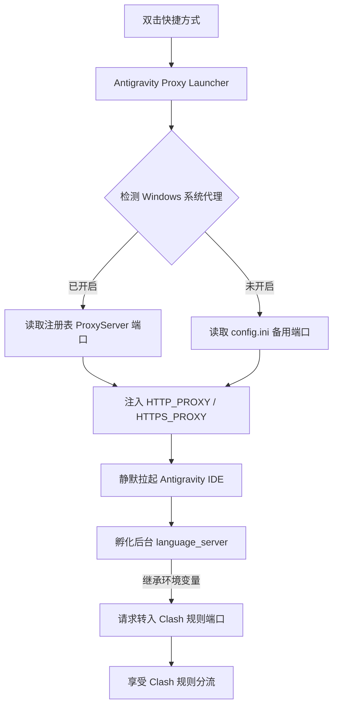

# Antigravity Proxy Launcher (Windows) 🚀

> 专为 **Antigravity IDE** 设计的免 TUN 规则代理启动器。彻底解决后台语言服务（Go 实现）因读不到 Windows 注册表系统代理导致的网络连接中断、TLS 重置与 `unexpected EOF` 问题。

---

## 📌 痛点背景与根本原因

在 Windows 系统下使用 Antigravity IDE 搭配 Clash、Clash Verge、v2rayN 等代理工具时，经常会遇到以下报错：

```text
Error: request failed: Post "https://daily-cloudcode-pa.googleapis.com/v1internal:streamGenerateContent?alt=sse": 
Post "https://oauth2.googleapis.com/token": unexpected EOF: request failed...
```

### 为什么开启了系统代理依然报错？
1. **进程模型差异**：Antigravity IDE 并非单一进程，真正向 Google Cloud Code / Gemini 服务发起网络请求的是内部后台进程 **`resources/bin/language_server`**（由 Go 语言编写）。
2. **Go 标准库网络机制**：Go 的 `net/http` 官方实现仅通过环境变量（`HTTP_PROXY` / `HTTPS_PROXY`）获取代理，**完全不读取 Windows 注册表（WinINet）中的系统代理**。
3. **传统解决方式的缺点**：
   - **开启 TUN 模式**：通过虚拟网卡接管所有系统流量。虽然有效，但资源开销大、权限要求高、容易与局域网或其他网络适配器冲突。
   - **修改系统全局环境变量**：污染整个系统环境，导致未开代理时其他 CLI 工具（如 git, curl, pip）报 `Connection refused`。

---

## 💡 解决方案

本启动器采用**“环境注入 + 动态适配”**的方式：
1. **自动读取系统代理**：在启动时实时检测 Windows 注册表中的代理开关状态与端口（无论是 7890、7897 还是 7898）。
2. **父子进程环境变量继承**：为 Antigravity IDE 主进程注入 `HTTP_PROXY` / `HTTPS_PROXY`，主进程孵化 `language_server` 时，子进程自动继承该配置。
3. **完美遵循规则模式**：流量直接进入 Clash 等客户端的混合端口，直接享受规则模式分流（国外节点加速、国内与本地直连），**彻底免开 TUN 模式**。
4. **零依赖与无黑框**：纯原生 VBScript + PowerShell 实现，零外部依赖，启动不闪黑框。



---

## 🛠️ 安装与使用

### 方式一：下载源码一键安装（推荐）

1. 点击 GitHub 右上方 **`Code` -> `Download ZIP`** 解压到任意目录（例如 `D:\tools\antigravity-proxy-launcher`）。
2. 双击运行目录下的 **`install.bat`**。
3. 脚本会自动检测 Antigravity 安装路径，并在桌面生成带有官方图标的 **`Antigravity IDE (Clash代理)`** 快捷方式。
4. 以后只需双击该快捷方式启动即可！

### 方式二：单行命令安装（PowerShell）

打开 PowerShell 执行以下命令：

```powershell
git clone https://github.com/YOUR_USERNAME/antigravity-proxy-launcher.git "$env:LOCALAPPDATA\antigravity-proxy-launcher"
& "$env:LOCALAPPDATA\antigravity-proxy-launcher\install.ps1"
```

---

## ⚙️ 配置文件说明 (`config.ini`)

通常情况下启动器会**自动识别**系统的当前代理。如果日常不开启“系统代理”开关，仅常驻后台代理端口，可修改 `config.ini`：

```ini
[proxy]
; 当系统未开启代理时，回退到此默认端口
default_proxy=http://127.0.0.1:7898

; 自定义 Antigravity IDE 安装路径（留空则自动检测）
custom_exe_path=
```

| 常用代理客户端 | 默认混合/HTTP 端口 |
| :--- | :--- |
| **Clash Verge Rev / Mihomo** | `7897` 或 `7898` |
| **Clash for Windows / 原版 Clash** | `7890` |
| **v2rayN** | `10809` |
| **Sing-box** | `2080` |

---

## 🗑️ 卸载

双击运行 **`uninstall.bat`** 即可自动清除桌面快捷方式。

---

## 📄 开源许可证

本项目基于 [MIT License](LICENSE) 开源。欢迎提交 Issue 与 Pull Request！
