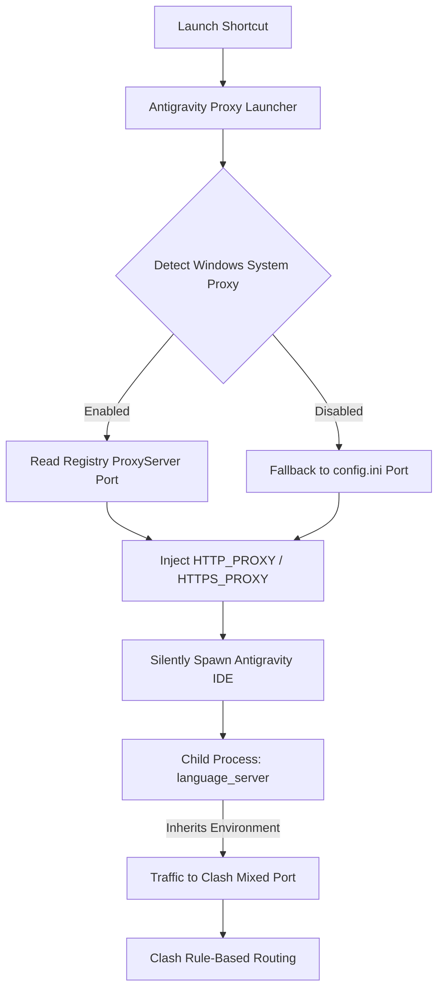
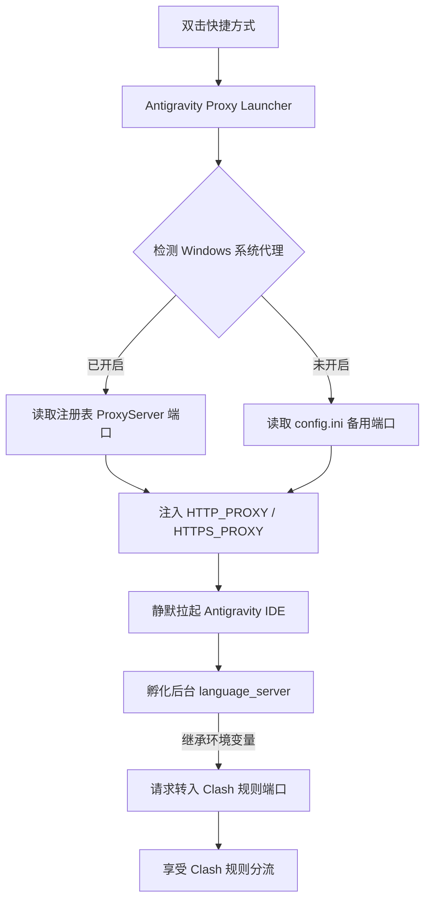

# Antigravity Proxy Launcher (Windows) 🚀

<p align="center">
  <b>A lightweight, TUN-free proxy launcher designed for Antigravity IDE.</b><br>
  <b>专为 Antigravity IDE 设计的免 TUN 规则代理启动器。</b>
</p>

<p align="center">
  <a href="#english">English</a> •
  <a href="#简体中文">简体中文</a>
</p>

---

## English

A lightweight, zero-dependency, TUN-free proxy launcher for **Antigravity IDE** on Windows. Completely solves connection timeouts, TLS resets, and `unexpected EOF` errors caused by background Go-based language servers failing to read Windows registry system proxies.

### 📌 Problem & Root Cause

When using Antigravity IDE on Windows with proxy clients like Clash, Clash Verge, or v2rayN in System Proxy mode, users frequently encounter errors like:

```text
Error: request failed: Post "https://daily-cloudcode-pa.googleapis.com/v1internal:streamGenerateContent?alt=sse": 
Post "https://oauth2.googleapis.com/token": unexpected EOF: request failed...
```

#### Why does it fail even when System Proxy is enabled?

1. **Multi-Process Architecture**: Antigravity IDE is not a single executable. Network requests to Google Cloud Code / Gemini are dispatched by an internal background binary: `resources/bin/language_server.exe` (written in Go).
2. **Go's `net/http` Limitation**: Go standard library's `net/http` only checks environment variables (`HTTP_PROXY`, `HTTPS_PROXY`, `ALL_PROXY`). It **never** inspects the Windows WinINet registry settings modified by proxy clients.
3. **Flaws of Alternative Workarounds**:
   - **TUN Mode**: Creates a virtual network adapter to intercept all L3 packets. While it works, it consumes more resources, requires administrator privileges, and often conflicts with WSL, Docker, and local VPNs.
   - **Global Windows Environment Variables**: Pollutes system-wide environment variables, causing other CLI tools (e.g. `git`, `curl`, `pip`) to fail with `Connection refused` when the proxy client is closed.

### 💡 How It Works

This launcher adopts a **"Process-Level Environment Injection + Dynamic Adaptation"** approach:

1. **Dynamic Registry Detection**: Checks Windows registry (`HKCU\Software\Microsoft\Windows\CurrentVersion\Internet Settings`) in real-time to retrieve the active proxy port (`7890`, `7897`, `7898`, etc.).
2. **Process Inheritance**: Injects proxy environment variables into the Antigravity IDE process on launch. All spawned child processes (including `language_server`) automatically inherit them.
3. **Seamless Rule Mode**: Directs traffic to Clash's mixed port, letting Clash apply its rule-based routing (direct domestic traffic, proxied international traffic) **without TUN mode**.
4. **Zero Dependencies & Zero Console Flash**: Written in native VBScript and PowerShell. Runs silently in the background without annoying CMD flash windows.



### 🛠️ Installation & Usage

#### Option 1: One-Click Installer (Recommended)

1. Download or clone this repository to any directory (e.g. `D:\tools\antigravity-proxy-launcher`).
2. Double-click **`install.bat`**.
3. The script automatically detects the Antigravity IDE installation and creates a desktop shortcut **`Antigravity IDE (Clash代理)`** with the official icon.
4. Launch the IDE from this desktop shortcut!

#### Option 2: PowerShell One-Liner

```powershell
git clone https://github.com/minoruLiu/antigravity-proxy-launcher.git "$env:LOCALAPPDATA\antigravity-proxy-launcher"
& "$env:LOCALAPPDATA\antigravity-proxy-launcher\install.ps1"
```

### ⚙️ Configuration (`config.ini`)

By default, the launcher dynamically follows your Windows system proxy. If you keep system proxy disabled and only run Clash background ports, you can specify a fallback port in `config.ini`:

```ini
[proxy]
; Fallback proxy when Windows system proxy is disabled
default_proxy=http://127.0.0.1:7898

; Custom Antigravity IDE executable path (leave empty for auto-detection)
custom_exe_path=
```

| Proxy Client | Default Mixed / HTTP Port |
| :--- | :--- |
| **Clash Verge Rev / Mihomo** | `7897` or `7898` |
| **Clash for Windows / Vanilla Clash** | `7890` |
| **v2rayN** | `10809` |
| **Sing-box** | `2080` |

### 🗑️ Uninstallation

Double-click **`uninstall.bat`** to remove the desktop shortcut.

<p align="right"><a href="#antigravity-proxy-launcher-windows-">Back to top ↑</a></p>

---

## 简体中文

专为 **Antigravity IDE** 设计的免 TUN 规则代理启动器。彻底解决后台语言服务（Go 实现）因读不到 Windows 注册表系统代理导致的网络连接中断、TLS 重置与 `unexpected EOF` 报错。

### 📌 痛点背景与根本原因

在 Windows 系统下使用 Antigravity IDE 搭配 Clash、Clash Verge、v2rayN 等代理工具时，经常会遇到以下报错：

```text
Error: request failed: Post "https://daily-cloudcode-pa.googleapis.com/v1internal:streamGenerateContent?alt=sse": 
Post "https://oauth2.googleapis.com/token": unexpected EOF: request failed...
```

#### 为什么开启了系统代理依然报错？

1. **多进程架构**：Antigravity IDE 并非单一进程，真正向 Google Cloud Code / Gemini 服务发起网络请求的是内部后台进程 **`resources/bin/language_server.exe`**（由 Go 语言编写）。
2. **Go 标准库网络机制**：Go 的 `net/http` 官方实现仅通过环境变量（`HTTP_PROXY` / `HTTPS_PROXY`）获取代理，**完全不读取 Windows 注册表（WinINet）中的系统代理**。
3. **传统解决方式的缺点**：
   - **开启 TUN 模式**：通过虚拟网卡接管所有系统流量。虽然有效，但资源开销大、权限要求高、容易与 WSL/Docker 或其他网络适配器冲突。
   - **修改系统全局环境变量**：污染整个系统环境，导致未开代理时其他命令行工具（如 git, curl, pip）报 `Connection refused`。

### 💡 解决方案与架构

本启动器采用 **“进程级环境注入 + 动态适配”** 的架构方案：

1. **自动读取系统代理**：在启动时实时检测 Windows 注册表中的代理开关状态与端口（无论是 7890、7897 还是 7898）。
2. **父子进程环境变量继承**：为 Antigravity IDE 主进程注入 `HTTP_PROXY` / `HTTPS_PROXY`，主进程孵化 `language_server` 时，子进程自动继承该配置。
3. **完美遵循规则模式**：流量直接进入 Clash 等客户端的混合端口，直接享受规则模式分流（国外节点加速、国内与本地直连），**彻底免开 TUN 模式**。
4. **零依赖与无黑框**：纯原生 VBScript + PowerShell 实现，零外部依赖，启动不闪黑框。



### 🛠️ 安装与使用

#### 方式一：一键安装（推荐）

1. 下载或 Clone 本仓库到任意目录（例如 `D:\tools\antigravity-proxy-launcher`）。
2. 双击运行目录下的 **`install.bat`**。
3. 脚本会自动检测 Antigravity 安装路径，并在桌面生成带有官方图标的 **`Antigravity IDE (Clash代理)`** 快捷方式。
4. 以后只需双击该快捷方式启动即可！

#### 方式二：PowerShell 单行命令安装

```powershell
git clone https://github.com/minoruLiu/antigravity-proxy-launcher.git "$env:LOCALAPPDATA\antigravity-proxy-launcher"
& "$env:LOCALAPPDATA\antigravity-proxy-launcher\install.ps1"
```

### ⚙️ 配置文件说明 (`config.ini`)

通常情况下，启动器会 **自动识别** 系统的当前代理。如果日常不开启“系统代理”开关，仅常驻后台代理端口，可修改 `config.ini`：

```ini
[proxy]
; 当系统未开启代理时，回退到此默认端口
default_proxy=http://127.0.0.1:7898

; 自定义 Antigravity IDE 安装路径（留空则自动检测）
custom_exe_path=
```

| 常用代理客户端 | 默认混合/HTTP 端口 |
| :--- | :--- |
| **Clash Verge Rev / Mihomo** | `7897` 或 `7898` |
| **Clash for Windows / 原版 Clash** | `7890` |
| **v2rayN** | `10809` |
| **Sing-box** | `2080` |

### 🗑️ 卸载

双击运行 **`uninstall.bat`** 即可自动清除桌面快捷方式。

<p align="right"><a href="#antigravity-proxy-launcher-windows-">回到顶部 ↑</a></p>

---

## 📄 License

MIT License © 2026 Antigravity Proxy Launcher Contributors
